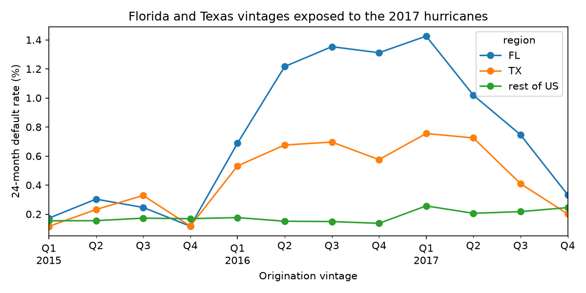
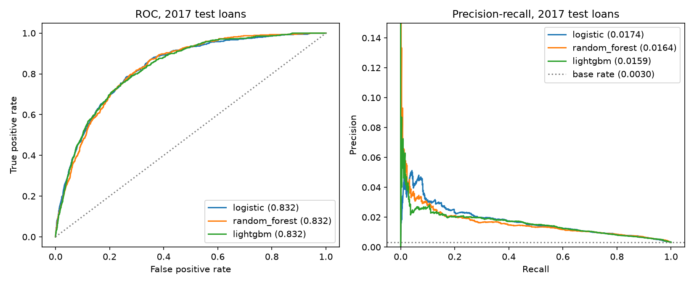

# Fannie Mae loan default model

Predicts whether a Fannie Mae single-family mortgage seriously defaults within two years, using only what is known when the loan is made. Logistic regression, a random forest and LightGBM are compared on loans from a later year than the ones they were trained on.

## Question and data

- **Data:** Fannie Mae's Single-Family Loan Performance Data (Data Dynamics, capitalmarkets.fanniemae.com) (Primary dataset), acquisition quarters 2015Q1–2017Q4. One monthly record per loan, 113 pipe-delimited columns, about 106 GB unzipped. **No data is included in this repo;** the terms of use forbid redistributing it. Downloading needs a free Data Dynamics account.
- **Sample:** a deterministic 10% of loans (CRC32 hash of the loan ID), keeping every monthly record of a sampled loan. The sample has 602,838 loans originated 2015Q1–2017Q4.
- **Label (`default_24m`):** 1 if, within 24 months of the first payment, the loan was ever **180+ days delinquent** or ended with a loss-type zero-balance code (`02`, `03`, `09`, `15`). Loans observed for less than 24 months that neither defaulted nor paid off are dropped as right-censored. The default rate is 0.240%.
- **Features:** 17 origination fields only: credit scores, LTV/CLTV, DTI, rate, balance, term, number of borrowers, mortgage insurance, channel, purpose, property type, occupancy, units, first-time buyer flag, state.

### Why 180 days, not 90

With a 90-day label, Florida and Texas loans whose 24-month window covered August–September 2017 defaulted at 5–8× the national rate. Hurricanes Harvey and Irma put borrowers into forbearance while missed payments kept counting. The 180-day label removes most of that, but Florida's 2016 vintages still run about 8× the rest of the country, and the data's borrower-assistance field marks only ~6% of those delinquencies. So every model is scored twice: on all loans, and excluding Florida and Texas.



## Method

- **Out-of-time split:** train on 2015–2016 vintages (421,633 loans, 0.213% default), test on 2017 vintages (181,205 loans, 0.304%). This is how a credit model is used, and it exposes drift that a random split hides.
- **Models:** class-weighted logistic regression (median imputation with missing indicators, scaling, one-hot); random forest (500 trees, `min_samples_leaf=50`, `balanced_subsample`); LightGBM (learning rate 0.03, early stopping on the held-out 2016Q4 vintage, which stopped at 229 trees).
- **Evaluation:** ROC AUC, PR AUC (the more informative one at a 0.3% base rate), Brier score, a calibration plot, a cost-minimizing flag threshold at several miss-to-false-alarm cost ratios, and permutation importance on the test set.

## Results (2017 test vintages)

| Model | ROC AUC | ROC AUC, excl. FL+TX | PR AUC | Brier |
|---|---|---|---|---|
| Logistic regression | 0.832 | 0.828 | 0.0174 | 0.207 |
| Random forest | 0.832 | 0.824 | 0.0164 | 0.047 |
| LightGBM | 0.832 | 0.824 | 0.0159 | 0.003 |

PR AUC no-skill baseline: 0.0030. Brier scores of the class-weighted models reflect inflated scores, not worse ranking.



**At a realistic 100:1 cost ratio** (a defaulted loan can lose tens of thousands of dollars; a false alarm costs a review), flagging the riskiest ~8% of loans catches ~45% of defaults and cuts total cost by about 19% versus flagging none. At 10:1 the cheapest policy is to flag nobody.

### Findings

1. **The three models tie.** A linear model, a forest and boosting reaching the same ROC AUC means the ceiling is the information in origination data, not model flexibility.
2. **Credit score dominates.** Borrowers at 620–679 default at 1.10% versus 0.077% at 740+. It is the top input by permutation importance (0.113 AUC drop), well ahead of state (0.032) and DTI (0.013).
3. **The flexible models lean more on the hurricanes:** they lose 0.008 AUC without Florida and Texas, against 0.005 for logistic regression, and rank `STATE` second.
4. **Only LightGBM is calibrated.** Trained without class weights, its scores track observed default rates; the weighted models only rank.
5. **Drift:** the forest's out-of-bag AUC on 2015–2016 loans is 0.860, and LightGBM's 2016Q4 validation AUC is 0.883, against 0.832 on 2017 loans.

## Limitations

- A 10% loan sample of three years of originations; results are not tuned or cross-validated beyond early stopping.
- Origination data only: no payment history, home-price changes or local unemployment, which is why the models plateau.
- The 2017 hurricanes still affect the label for Florida and Texas; the robustness columns bound their influence rather than removing it.
- The cost ratios are illustrative, not Fannie Mae's actual loss and servicing costs.

## Reproduce

```bash
uv sync
# put 2015Q1.csv ... 2017Q4.csv in data/raw/
uv run python -m fannie_default.build --raw data/raw --quarters 2015Q1 2017Q4 --rate 0.10
uv run pytest
cd notebooks && uv run jupyter nbconvert --to notebook --execute --inplace 01_vintage_analysis.ipynb 02_model_comparison.ipynb
```

The build takes about 11 minutes and 3 GB of memory; the comparison notebook takes a few minutes.

## Layout

```
src/fannie_default/   layout, load, labels, build (CLI), vintage, features, models, evaluate
notebooks/            01_vintage_analysis, 02_model_comparison
reports/              figures and metrics.json (aggregates only)
tests/                synthetic-data tests for every module
```
